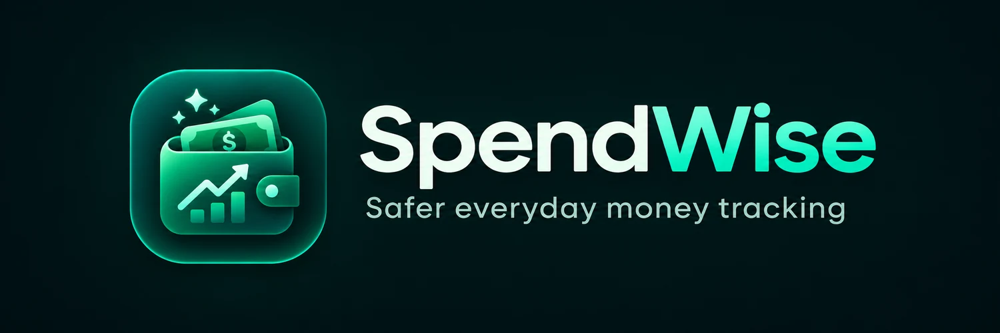
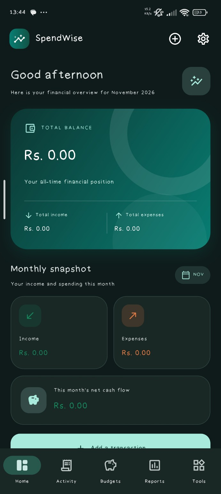
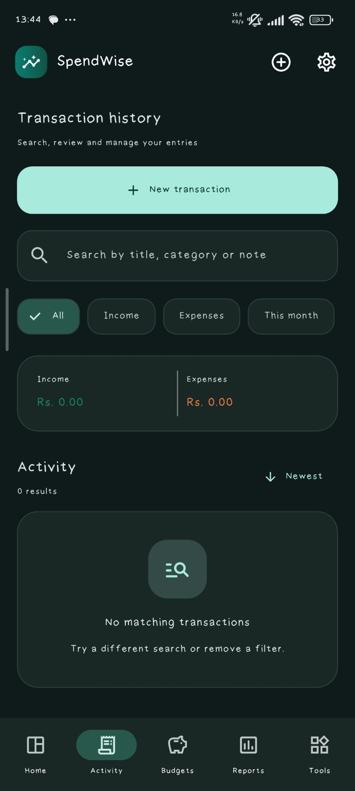
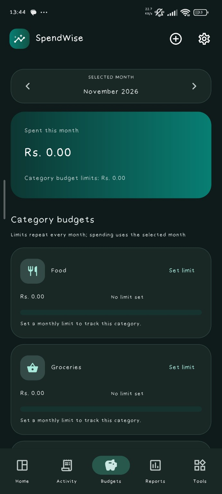
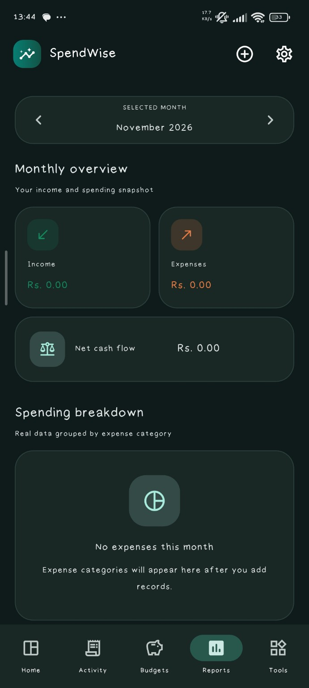
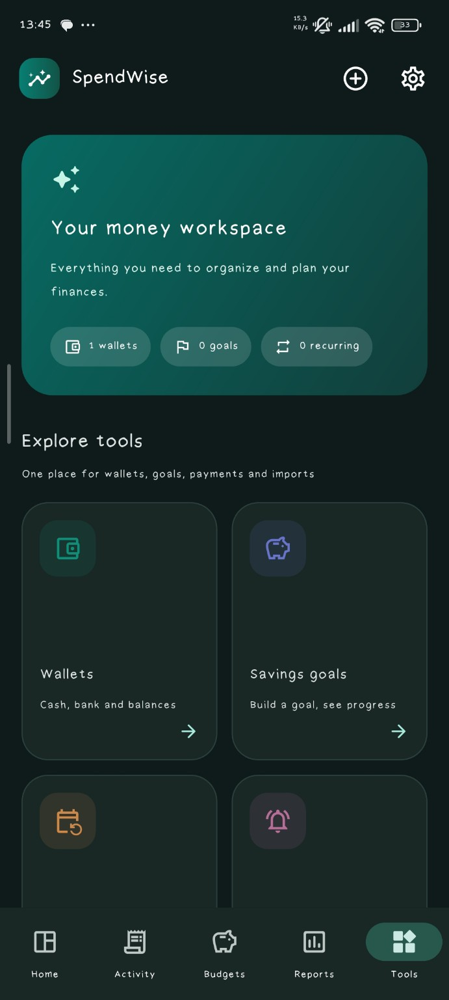
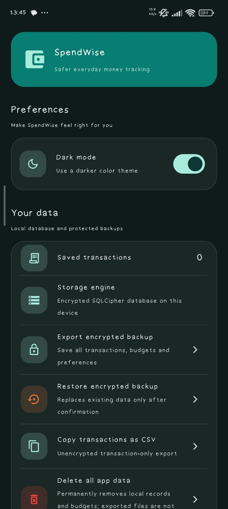

<div align="center">
  

  <br />

  [](https://github.com/Kumarathunga2003/spendwise/releases/tag/v1.0.0)
  
  
  

  **Spend smarter. Stay organized. Feel more in control of your money.**

  A clean, offline-first Android finance app for everyday expenses, budgets, and saving goals.

  ### [📥 Download SpendWise for Android](https://github.com/Kumarathunga2003/spendwise/releases/tag/v1.0.0)

  [View latest release](https://github.com/Kumarathunga2003/spendwise/releases/latest) · [Report an issue](https://github.com/Kumarathunga2003/spendwise/issues) · [Source code](https://github.com/Kumarathunga2003/spendwise)
</div>

---

## Meet SpendWise

Keeping track of money shouldn't be complicated. **SpendWise** brings your income, expenses, monthly budgets, and savings plans together in one easy-to-use Android app. Record transactions as they happen, understand your spending habits, and make better decisions about what comes next.

The app is designed to work **without an account or cloud sync**. Your financial records stay on your device, with encrypted backup and restore options when you need to move or protect your data.

## A look inside

<div align="center">
  <table>
    <tr>
      <td align="center"><br /><b>Home</b></td>
      <td align="center"><br /><b>Activity</b></td>
      <td align="center"><br /><b>Budgets</b></td>
    </tr>
    <tr>
      <td align="center"><br /><b>Reports</b></td>
      <td align="center"><br /><b>Money tools</b></td>
      <td align="center"><br /><b>Settings</b></td>
    </tr>
  </table>
</div>

> **Screenshot note:** These are real development screenshots of SpendWise. Some screens may show an earlier logo or empty sample data; the current APK uses the updated emerald-wallet branding. Replace the images with fresh captures from the released APK whenever convenient.

## Everything you need to manage your money

| | Feature | What it helps you do |
|:--:|---|---|
| 💸 | **Income & expense tracking** | Add, edit, delete, search, and filter transactions. |
| 📊 | **Financial dashboard** | Check your balance, total income, total expenses, and recent activity. |
| 🎯 | **Monthly budgets** | Set category-based limits and see when spending needs attention. |
| 📈 | **Reports & insights** | Explore monthly totals, category spending, and trends. |
| 👛 | **Multiple wallets** | Keep cash and other wallet balances organized separately. |
| 🏁 | **Savings goals** | Set targets and track progress toward them. |
| 🔄 | **Recurring transactions** | Set up regular income or expenses; due entries are processed when the app opens or when you sync them. |
| 🔔 | **Expense reminders** | Set local Android reminders for upcoming expenses (notification permissions and phone settings may affect delivery). |
| 📄 | **CSV tools** | Import supported transaction CSV files, check duplicates, and export transaction records. |
| 🔐 | **PIN app lock** | Add an optional 6–12 digit PIN to control access to the app. |
| 🗄️ | **Encrypted local storage** | Store financial information in a local SQLCipher-encrypted SQLite database on Android. |
| 💾 | **Encrypted backups** | Export and restore protected financial backups with a passphrase. |
| 🌗 | **Light & dark themes** | Switch between two clean, comfortable layouts. |

## Made for everyday use

- **Simple first:** Clear totals, readable cards, and tools you can find without digging through menus.
- **Useful insights:** See how much is coming in, going out, and left for your goals.
- **Your phone, your records:** No registration is required to track money locally.
- **Safer data handling:** Encrypted storage, optional PIN protection, and passphrase-protected backups.

## Download and install

**Current release:** `1.0.0+1` · **Android APK**

1. Open the **[SpendWise v1.0.0 release page](https://github.com/Kumarathunga2003/spendwise/releases/tag/v1.0.0)**.
2. Under **Assets**, download the Android APK (`SpendWise-v1.0.0.apk` if that is the uploaded filename).
3. Open the downloaded file on your Android phone.
4. If Android asks, allow installation **from this trusted source** and complete the installation.
5. Open SpendWise and begin tracking your finances.

> **Important:** SpendWise is distributed via GitHub, not Google Play. Download only from this project's official release page. If the APK name differs, choose the `.apk` file attached to the release. Keep a verified backup before updating an existing installation.

## Privacy and security

SpendWise is **offline-first**. It does not require an account to manage your personal records and it is designed to keep the main financial database on your device.

- **Local database:** SQLCipher-encrypted SQLite storage on Android.
- **Optional app lock:** PIN protection for opening the app; it does not replace your phone's own security.
- **Backup and restore:** Encrypted backups use a passphrase you should keep safe.
- **CSV exports:** Transaction CSV exports are **not encrypted**. Store and share them carefully.
- **Notifications:** Expense reminders rely on Android notification permissions and system scheduling.

There is no cloud synchronization in this release. Data can be lost if your device is reset or the app is uninstalled without a usable backup.

## Built with

- **Flutter & Dart** — Android app, UI, and application logic.
- **Material Design** — Responsive components, navigation, and light/dark themes.
- **SQLite + SQLCipher** — Local financial records with encryption at rest.
- **Flutter secure storage** — Secure handling of app secrets and PIN-related settings.
- **Local notifications** — On-device expense reminders.

## Run it locally (developers)

You'll need the [Flutter SDK](https://docs.flutter.dev/get-started/install), Android development tools, and an emulator or Android phone.

```bash
git clone https://github.com/Kumarathunga2003/spendwise.git
cd spendwise
flutter pub get
flutter analyze
flutter test
flutter run
```

> **Release builds:** The Android release build requires your **own private signing configuration**. Never commit `android/key.properties`, `.jks` files, passwords, or financial backups to Git.

## Feedback

Found a problem or have a suggestion? I'd be happy to hear it. Please [open a GitHub Issue](https://github.com/Kumarathunga2003/spendwise/issues) and include the app version, device model, and steps to reproduce the issue. **Do not post private financial information, PINs, or backup passwords.**

---

<div align="center">
  

  <p><b>SpendWise 1.0</b> · Safer everyday money tracking</p>
  <p>Created by <a href="https://github.com/Kumarathunga2003">R.P.G.B Kumarathunga</a></p>
  <p>Made with Flutter 💚</p>
</div>
